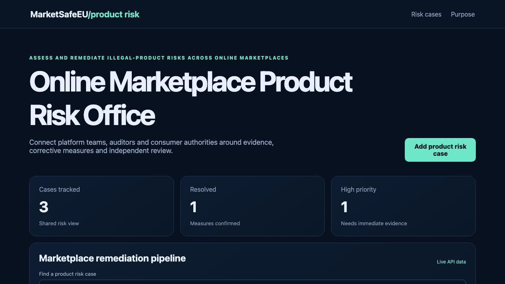

# Online Marketplace Product Risk Office

## One-sentence benefit

Coordinate illegal-product risk assessment and marketplace corrective measures with clear evidence and ownership.

## Live demo

[Watch the workflow](docs/demo.webm).

## Screenshots

## Main features

- Search and sort a shared product-risk pipeline.
- Create validated risk cases with accountable owners and priorities.
- Move cases through draft, review and resolved states.
- See loading, empty, error and success feedback.
- Use separate risk and purpose pages on desktop or mobile.

## Technology used

React, TypeScript, TanStack Query, Wouter, Vite, Spring Boot and Java 21.

## Installation instructions

Install Node.js 22 and Java 21. Run `npm install`, then start the backend with `cd backend && mvn spring-boot:run`. In another terminal run `npm run dev`.

## Commercial licensing/contact

Commercial licensing and integration support are available. Use the repository contact options to discuss deployment.

## Business problem and users

Online marketplaces, auditors and consumer authorities need one view of illegal-product risks, responsible teams, corrective measures and independent evidence.

## Key workflows

Search the risk register, open a validated case, assign its platform owner, advance it after evidence review and confirm the change through the live Java API.

## React framework highlights

TanStack Query manages server state and cache refreshes, Wouter provides two client routes, and typed React forms drive API writes.

## Java backend highlights

Spring Boot exposes list, search, create and update endpoints, Bean Validation returns clear errors, Actuator provides health status, and service tests cover domain behaviour.

## Architecture and state flow

React reads and writes `/api/items`. Vite proxies requests to Spring Boot. The controller validates input, the service applies domain transitions and the in-memory data layer returns the updated record.

## Accessibility and responsive behaviour

Semantic landmarks, visible labels, keyboard-ready controls, strong focus states and responsive cards support narrow and wide screens.

## Verification commands

Run `npm test`, `npm run lint`, `npm run build`, `cd backend && mvn test` and `cd backend && mvn package`.

## Structure

`src` contains the React application, `backend` contains the Java service, and `docs` contains inspected product media.

## Tradeoffs

The sample stores data in memory so it is easy to run. Production use should add authenticated users, persistent storage and event integration.

## Roadmap

Add seller traceability feeds, audit evidence, product alerts and role-based remediation approvals.
